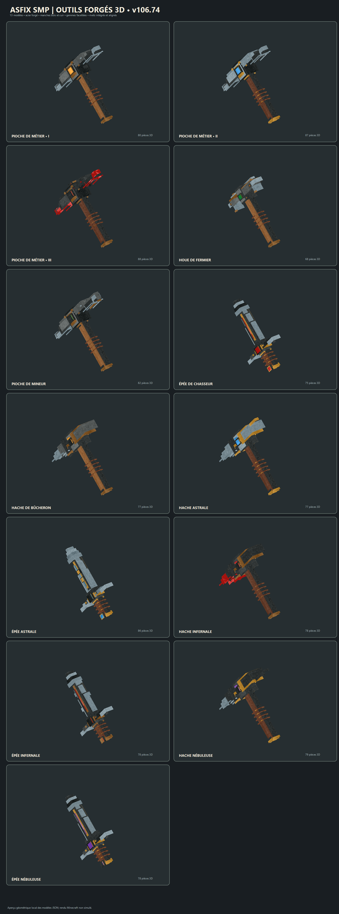

# ASFIX SMP Java Resource Pack — v106.74

[Download the Java 26.2 resource pack](AsfixSMP-Java-ResourcePack-26.2-v106.74-integrated-forged-3d-tools.zip)

## Handheld tools

This release improves the active 13 custom tools: three miner pickaxe tiers, miner and farmer job tools, woodcutter axe, hunter sword, and the Astral, Infernal and Nebula axe and sword sets. They are volumetric cuboid models in Minecraft's vanilla minecraft:item/handheld format, with real thickness on all three axes, sculpted heads and blades, reinforced grips, collars, and mounted 3D rivets.

The 13 material textures are 128×128 and use natural steel, forged iron, bronze, oak, walnut, stitched leather, and cut gemstone details. They include directional metal grain, forge marks, wood figuring, and faceted gem shading. v106.74 aligns every added rivet with the model's 45-degree tool transform, removing the detached appearance from the earlier preview. Texture generation now uses deterministic seeds. UVs follow each cuboid face's dimensions. Each model stays inside Minecraft's 16-unit item space and inherits the vanilla held-item transform. The preview is a static render from the model JSON and textures, not a Minecraft-client capture.

## ASFIX HUD

The archive retains the custom BetterHud HUD in the ASFIX natural-material theme: carved dark wood, bronze and steel edging, jade accents, a player head, rank and job details, coordinates, health, armor, hunger, balance, job experience and a framed hotbar. The HUD uses Oxanium and Silkscreen font atlases and includes 655 BetterHud assets.

The HUD source is under plugins/BetterHud in the central server folder. BetterHud 2.2.0-SNAPSHOT-449 previously generated the resource-pack assets on an isolated Paper 26.2 smoke server; this release does not claim a fresh in-game HUD screenshot.

## Release validation

- Target: Minecraft Java 26.2, resource-pack format 88.0.
- 13 active tool models, 1,033 positive-volume cuboids and 13 dedicated 128×128 material textures.
- All 13 ItemsAdder item definitions point to the matching handheld models. Every face texture and UV reference resolves; face UV regions stay inside the 16-unit texture coordinate range and scale with face geometry.
- All rotated model bounds remain inside 0–16 units.
- The 2,684-entry ZIP has no duplicate paths, and BetterHud assets are present.
- Minecraft-client rendering has not been verified in this release; confirm visuals in-game with the pack enabled.

Full machine-readable release metadata: release-v106.74.json.
