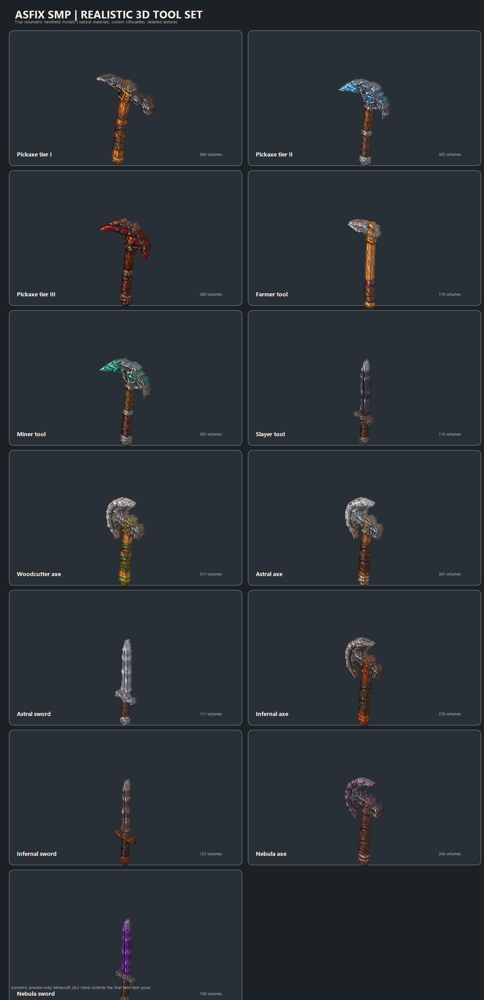

# ASFIX SMP Java Resource Pack — v106.75

[Download the Java 26.2 resource pack](AsfixSMP-Java-ResourcePack-26.2-v106.75-realistic-3d-tools.zip)

## Real 3D handheld tools

This release replaces the active 13 tool models: three miner pickaxe tiers, the Miner, Farmer, Slayer and Woodcutter job tools, and the Astral, Infernal and Nebula axe and sword sets. Each uses Minecraft's vanilla `minecraft:item/handheld` model format with actual cuboid geometry and thickness across the three axes. The detailed forged heads, blade profiles, wood handles, leather wraps, metal collars and gems use natural material colors.

The 13 models contain 2,930 non-zero-volume cuboids. Dedicated, high-resolution material textures carry the sculpted steel, iron, oak, walnut, leather and gem details. Item definition IDs remain stable, so the existing ItemsAdder items point to the updated models.

The image above is a static render from the model JSON and textures. The final held pose still needs confirmation in a Minecraft 26.2 client with ItemsAdder's pack enabled.

## ASFIX HUD

The archive retains the ASFIX BetterHud layout in a natural-material theme, with a player head, rank and job details, coordinates, health, armor, hunger, balance, job experience and framed hotbar. Oxanium and Silkscreen font atlases remain included; the BetterHud assets are unchanged in this release.

## Release verification

- Target: Minecraft Java 26.2, resource-pack format 88.0.
- 13 active tool models in vanilla handheld format.
- 2,930 positive-volume cuboids across the tools.
- 13 dedicated tool textures.
- Archive model texture references resolve, with no duplicate ZIP paths.
- Minecraft-client rendering has not been captured for this release.

Full machine-readable metadata: `release-v106.75.json`.