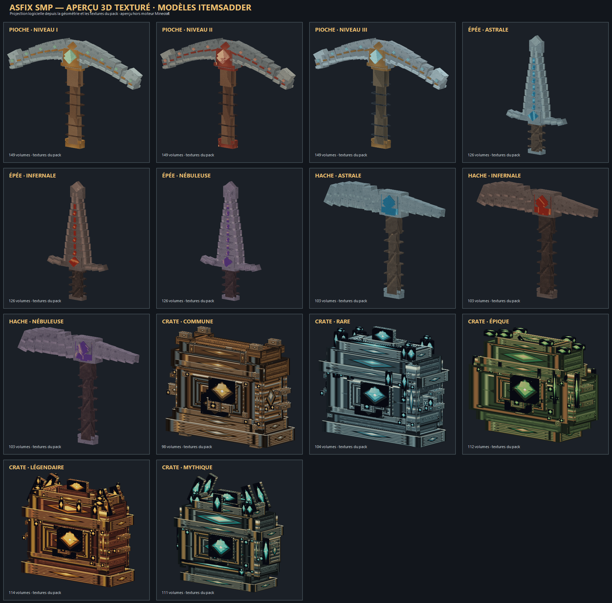

# ASFIX SMP — pack Java

Pack ItemsAdder et BetterHud pour Minecraft Java 26.2. La palette garde les matériaux naturels — acier, bois, cuir, bronze, pierre et jade — et réserve les couleurs vives aux gemmes et aux effets.

## Publication v106.27

- Les trois pioches, trois épées et trois haches évolutives ont une géométrie 3D faite de volumes texturés, avec têtes segmentées, arêtes, biseaux, renforts, gemmes et poignées travaillées.
- Les cinq caisses ItemsAdder restent des modèles 3D volumétriques détaillés et conservent leurs identifiants.
- Le pack contient 119 fichiers de modèle JSON, dont 115 modèles géométriques, 2 768 cuboïdes, 702 cuboïdes orientés et 16 608 références de faces texturées. Les 110 références de modèles d’objets ont été résolues.
- Le HUD BetterHud ASFIX conserve son thème bois, bronze et jade, sa police Oxanium, le portrait, le grade, le métier, les coordonnées, les jauges et le solde. Cette version améliore les modèles, pas la composition du HUD.
- Ciblage Minecraft Java 26.2, format 88.0. Les références ItemAdder et l’overlay BetterHud 26.2 sont inclus.

### Aperçu des modèles

La planche est un rendu logiciel local des éléments et textures JSON, hors moteur Minecraft. La galerie interactive complète des 115 modèles se trouve dans le dossier central ASFIX.

### Limites du rendu Minecraft

Les objets sont réellement volumétriques : leurs fichiers définissent de nombreux cuboïdes avec épaisseur et géométrie sur plusieurs axes. Le format d’objets vanilla ne permet pas un maillage libre avec matériaux PBR. Le style reste donc celui d’un modèle Minecraft texturé; l’aperçu hors jeu ne remplace pas une capture du client avec ItemsAdder activé.

### HUD

La composition reprend des repères de HUD d’aventure — informations joueur, position, niveau et jauges — dans une direction ASFIX originale. Les interfaces commerciales citées servent d’inspiration; leurs images et éléments propriétaires ne sont pas copiés.

## Archive

- Fichier : `AsfixSMP-Java-ResourcePack-26.2-v106.27.zip`
- Taille : 17 626 275 octets
- SHA-1 : `4114087D409D02766507E390558761B2C6DDA646`
- SHA-256 : `DE63A560C3CE3DC97F7A77355F80FA61B65B849867E96FAC83FECA15E63DCE98`
- [Télécharger le pack](AsfixSMP-Java-ResourcePack-26.2-v106.27.zip)
