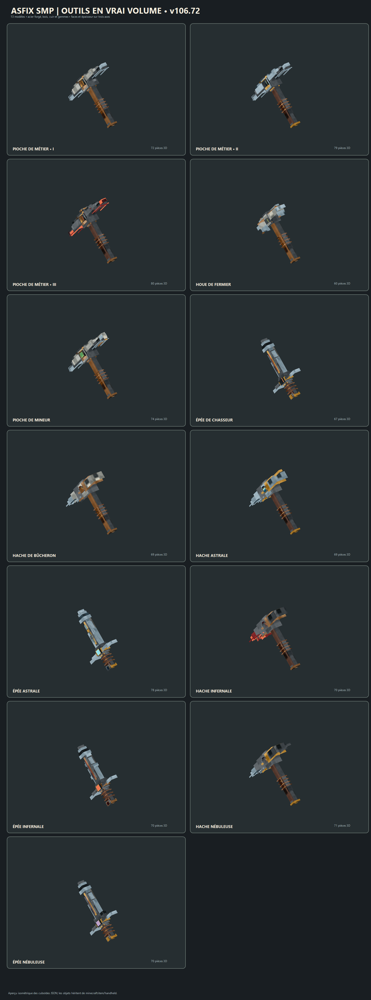

# ASFIX SMP Java Resource Pack — v106.72

[Download the Java 26.2 resource pack](AsfixSMP-Java-ResourcePack-26.2-v106.72-scale-correct-3d-tools.zip)

## Handheld tools

This release improves the active 13 custom tools: three miner pickaxe tiers, miner and farmer job tools, woodcutter axe, hunter sword, and the Astral, Infernal and Nebula axe and sword sets. They are volumetric cuboid models in Minecraft's vanilla `minecraft:item/handheld` format, with separate front and side geometry, natural wood and leather, forged metal, and restrained gem accents.

The UV mapping now follows each cuboid's actual face dimensions. This preserves the 64×64 texture detail on long hafts, thin edges and metal plates instead of stretching a whole material sheet over every small part. Each model remains within Minecraft's 16-unit item space. The preview is rendered from the model JSON and textures; it is a static isometric render rather than an in-client screenshot.

## ASFIX HUD

The archive retains the custom BetterHud HUD in the ASFIX natural-material theme: carved dark wood, bronze and steel edging, jade accents, a player head, rank and job details, coordinates, health, armor, hunger, balance, job experience and a framed hotbar. The HUD uses Oxanium and Silkscreen font atlases and includes 655 BetterHud assets.

The HUD source is under `plugins/BetterHud` in the central server folder. BetterHud 2.2.0-SNAPSHOT-449 previously generated the resource-pack assets on an isolated Paper 26.2 smoke server; this release does not claim a fresh in-game HUD screenshot.

## Release validation

- Target: Minecraft Java 26.2, resource-pack format 88.0.
- 13 active tool models, 929 positive-volume cuboids and 13 dedicated material textures.
- Every face texture and UV reference resolves; face UV regions stay inside the 16-unit texture coordinate range and scale with face geometry.
- All rotated model bounds remain inside 0–16 units.
- The 2,697-entry ZIP has no duplicate paths, and BetterHud assets are present.
- Minecraft-client rendering has not been verified in this release; confirm visuals in-game with the pack enabled.

Full machine-readable release metadata: [`release-v106.72.json`](release-v106.72.json).
