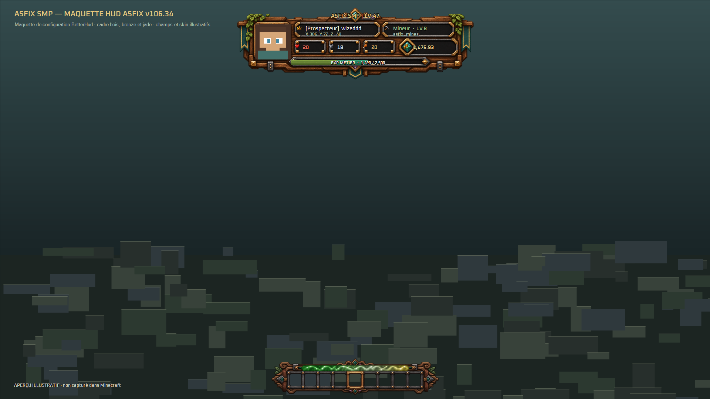
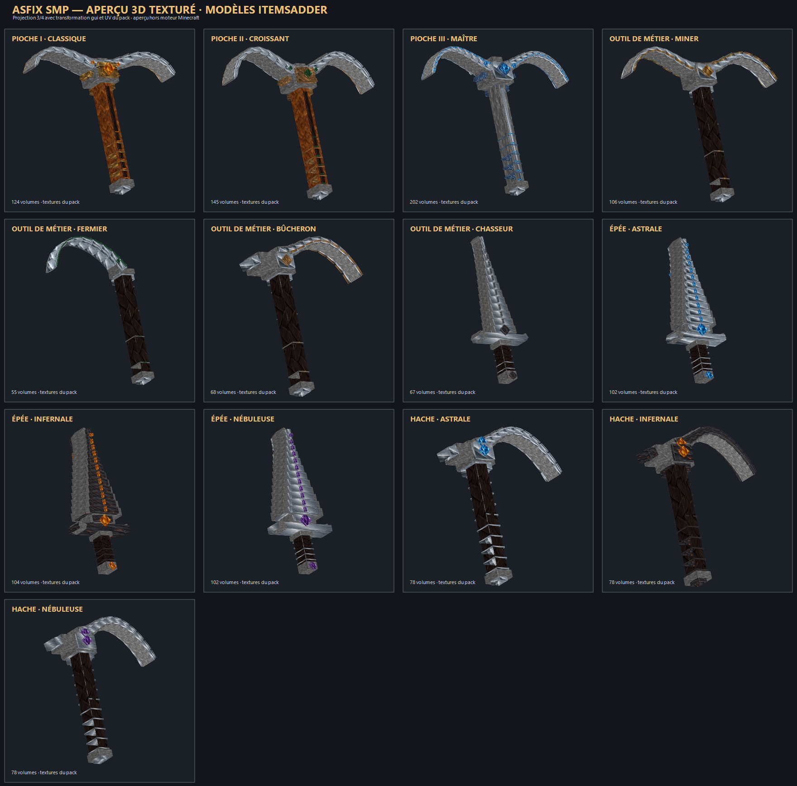
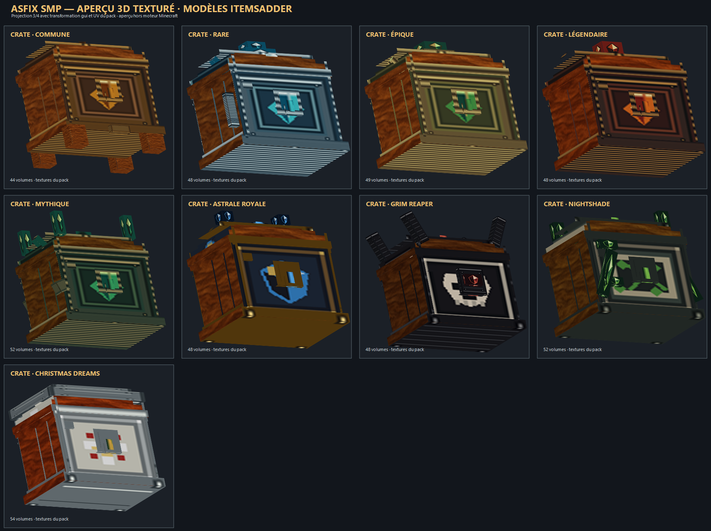
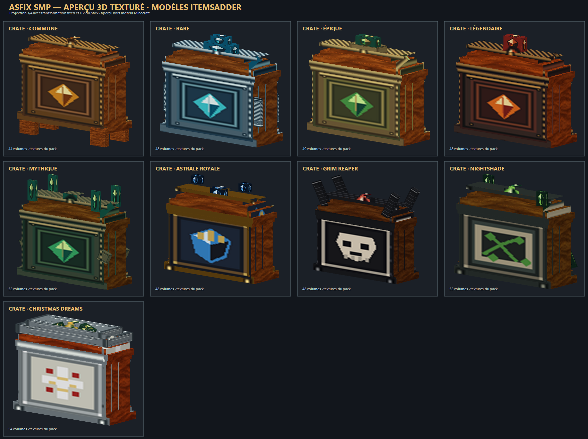
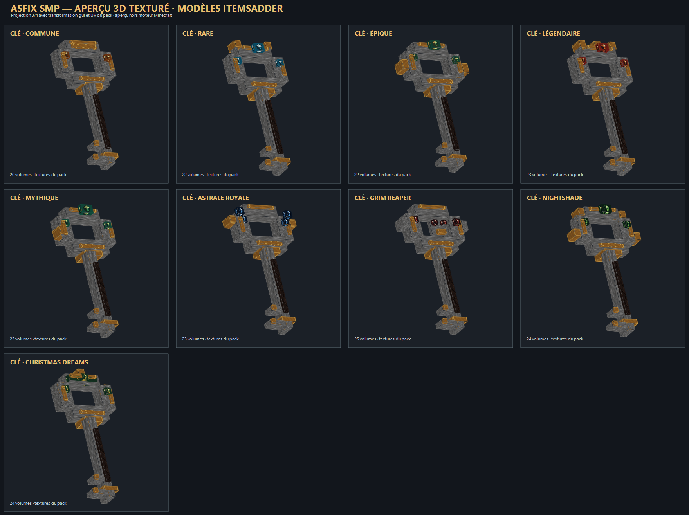

# ASFIX SMP — Resource pack Java 26.2

Pack ItemsAdder et BetterHud pour Minecraft Java 26.2. La direction visuelle ASFIX utilise des matériaux naturels — acier, fer sombre, bois, cuir, bronze et jade — avec des accents propres à chaque série.

## Publication v106.34

- 31 modèles de gameplay reliés aux contenus actifs : armes, outils, caisses et clés.
- 128 géométries de modèles volumétriques dans l’archive; 9 caisses de monde avec silhouettes et ornements distincts.
- HUD BetterHud ASFIX : cadre bois sombre, ferrures acier et bronze, touches jade, police Oxanium, profil, métier, coordonnées, statistiques, progression et barre personnalisée.
- Icônes de grades uniques et éléments d’interface assortis au thème ASFIX.
- Ressource préparée pour Minecraft Java 26.2, ItemsAdder et BetterHud.

### Aperçus

Les images ci-dessous sont des aperçus générés hors moteur Minecraft. Elles servent à examiner les modèles et la composition visuelle; elles ne prouvent pas le rendu dans un client connecté au serveur.

## Limites de rendu

Les modèles d’objets Minecraft sont construits avec des cuboïdes texturés et des faces orientées; ils ne sont pas des maillages PBR libres. Les modèles d’armes et de caisses ont du volume réel dans leurs définitions JSON, plutôt qu’une simple image plane ou un sprite épaissi. Les armures portées utilisent les couches de texture du joueur. Le rendu final dépend des versions installées d’ItemsAdder et BetterHud et doit encore être confirmé dans le client Minecraft du serveur.

## Archive

- Fichier : `AsfixSMP-Java-ResourcePack-26.2-v106.34.zip`
- Taille : 14 880 742 octets
- SHA-1 : `F7D8E911A813450A500DF342F44168284F038CA3`
- SHA-256 : `D8046D452895C70517487B00DFF9C9093D60E0F3024BAE613FEFECCD19A44A3F`
- [Télécharger le pack v106.34](AsfixSMP-Java-ResourcePack-26.2-v106.34.zip)

## Installation ItemsAdder et BetterHud

Sur le serveur, BetterHud doit générer ses ressources avec `/betterhud reload`, puis ItemsAdder reconstruire le resource pack avec `/iazip`. Cette reconstruction en direct et l’apparence finale dans Minecraft Java 26.2 ne sont pas revendiquées comme vérifiées par cette publication.
