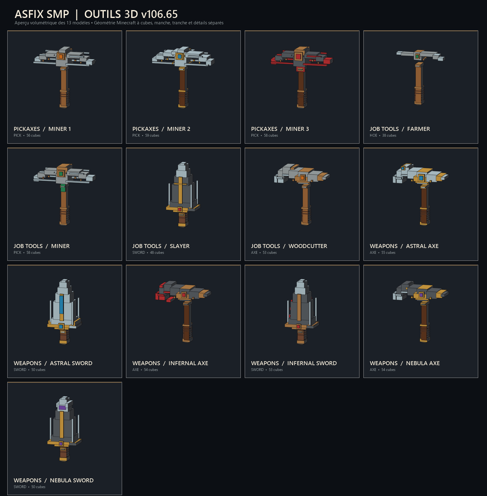

# ASFIX SMP Java Resource Pack — v106.65

[Download the Minecraft Java 26.2 pack](AsfixSMP-Java-ResourcePack-26.2-v106.65-realistic-3d-tools.zip)

## Tools

This release rebuilds 13 held-item models in Minecraft's native cuboid item format: three Miner pickaxes, four job tools, three axes and three swords. They use 686 separate cuboids across 13 distinct silhouettes, with broad stepped pick heads, beveled cutting edges, shaped axe cheeks, wider tapered sword blades, fitted guards, reinforced sockets and wrapped hafts. The models have real volume and side faces; they are not flat sprites or thickened PNGs. Their style remains voxel-based like vanilla Minecraft, with natural wood, leather, forged iron, cold steel, aged bronze, brass and restrained crystal accents.

The gallery is an isometric projection built from the model JSON geometry and texture samples. It helps inspect the shapes but does not replace an in-game render.

## HUD

The archive retains the custom ASFIX BetterHud theme in dark wood, bronze and jade. It includes the player head, rank, job and level, coordinates, health, armor, food, balance and job XP, with Oxanium SemiBold and Silkscreen fonts. BetterHud is disabled for Bedrock clients in its configuration. The updated v106.65 pack was validated statically; live rendering with the target BetterHud plugin still needs an in-game check.

## Release checks

- Target: Minecraft Java 26.2, resource format 88.0.
- 13 tool models, 686 cuboids, 13 distinct geometry shapes.
- 13 natural-material textures; every new tool texture is referenced.
- Five BetterHud configuration files are present.
- 2,712 ZIP entries; no duplicate paths.
- Obsolete v106.63 and v106.64 tool textures are absent.
- Archive size: 17,933,051 bytes.
- SHA-1: `C9C5E8F4E160E431BF21576AC69CA9D3636B9951`.
- SHA-256: `5812169BD705408FD17BF0A0B9301CE2C0FCC44388465650014C517440A6A164`.

The model archive passed structural checks for bounds, faces, texture references, unique geometry and archive integrity. Minecraft runtime rendering of this exact release has not yet been verified.