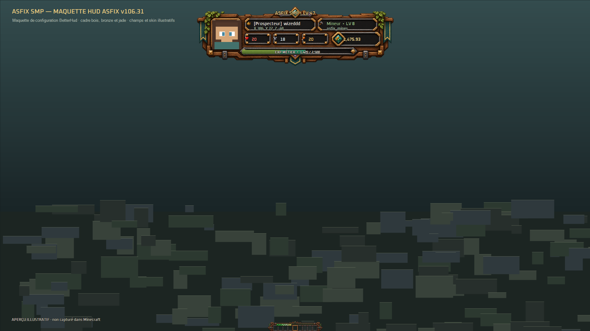
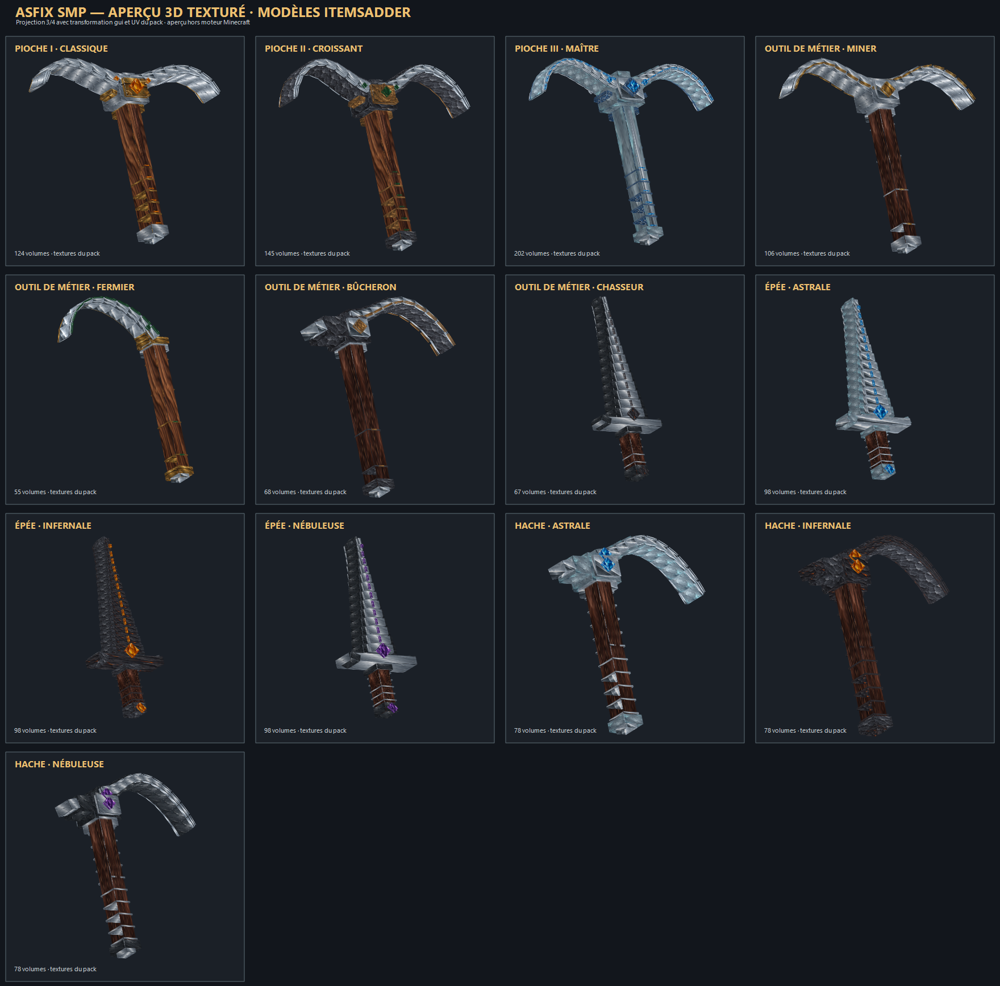

# ASFIX SMP — Resource pack Java 26.2

Pack ItemsAdder et BetterHud pour Minecraft Java 26.2. La direction visuelle ASFIX garde des matériaux naturels — acier, fer sombre, bois, cuir, bronze et jade — avec des accents colorés propres à chaque série.

## Publication v106.31

- 13 modèles d'équipement retravaillés en géométrie volumétrique : 3 pioches, 4 outils de métier, 3 épées et 3 haches.
- 9 caisses 3D thématiques conservées : 5 Cosmic et 4 collections.
- Les 22 modèles vedettes totalisent 1 680 cuboïdes 3D, avec géométries et textures distinctes. Les pioches et lames utilisent des arêtes biseautées, des formes effilées et des détails séparés en relief.
- HUD BetterHud ASFIX avec cadre bois sombre, ferrures acier et bronze, touches jade, police Oxanium et informations de profil, métier, coordonnées, statistiques et progression.
- Minecraft Java 26.2 : resource format 88.0 et overlay BetterHud 26.2.

### Aperçus

Les images sont des maquettes et projections calculées hors moteur Minecraft. Les modèles sont des volumes cuboïdes texturés conformes aux modèles d'objets Minecraft, pas des maillages PBR libres. Le rendu final dépend du client, d'ItemsAdder et de la fusion BetterHud sur le serveur.

## Archive

- Fichier : `AsfixSMP-Java-ResourcePack-26.2-v106.31.zip`
- Taille : 14 418 684 octets
- SHA-1 : `A574F60C6386466FA795D890E703DFD11A3DA014`
- SHA-256 : `837AA4058B643BE5328661670EBC4E06FC2BEF7D2B043D295830357D867E0751`
- [Télécharger le pack](AsfixSMP-Java-ResourcePack-26.2-v106.31.zip)

## Installation ItemsAdder et BetterHud

Le pack et les contenus ItemsAdder sont préparés localement. Sur le serveur, BetterHud doit générer ses ressources avec `/betterhud reload`, puis ItemsAdder reconstruire le resource pack avec `/iazip`. Cette reconstruction en direct et l'apparence finale dans un client Minecraft 26.2 n'ont pas encore été vérifiées.