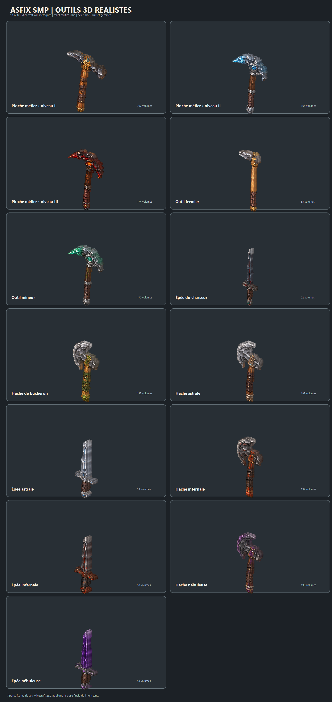

# ASFIX SMP Java Resource Pack — v106.70

[Download the Minecraft Java 26.2 resource pack](AsfixSMP-Java-ResourcePack-26.2-v106.70-handcrafted-voxel-tools.zip)

## 3D tools

This release contains 13 Minecraft-native handheld item models: three Miner pickaxes, four job tools, three axes and three swords. The models are made from **1,769 individual cuboids**, with layered bevels and visible side faces. They use Minecraft’s `minecraft:item/handheld` model parent and true cuboid geometry; they are not flat images with a thin extrusion.

The sword geometry now uses the intended width multiplier. Each of the three blades spans 6.975 model units, compared with 4.5 in the prior candidate, a 55% increase. The tool designs keep natural material colors: wood, leather, iron, steel, bronze, brass and restrained gem accents. The Nebula set retains its purple identity.

## ASFIX HUD

The pack includes the current custom BetterHud layout in dark wood, bronze and jade. It shows the player head, rank, job and level, coordinates, health, armor, food, balance and job XP. Oxanium and Silkscreen glyph atlases are generated from the BetterHud font files.

The HUD was generated with BetterHud 2.2.0-SNAPSHOT-449 and smoke-checked on an isolated Paper 26.2 server. BetterHud enabled successfully and generated the resource-pack assets. The gallery is a geometry projection; the full pack has not yet been visually confirmed in a Minecraft client.

## Build and validation

- Target: Minecraft Java 26.2, resource-pack format 88.0.
- 13 handheld models and 1,769 cuboids.
- 26 unique tool textures, including bevel/side-face textures.
- 655 BetterHud assets and 2 BetterHud shader files for the 26.2 overlay.
- 2,684 ZIP entries; no duplicate paths.
- No malformed UV coordinates, missing model textures, degenerate boxes or out-of-bounds geometry.
- Archive size: 17,522,808 bytes.
- SHA-1: `FD6EF0A5AC95D6A303B5502EF10678C2CE5C03FC`.
- SHA-256: `7DBB8B9B983B4F70D24F94E10452B14E499FC357ADF6B7C8A207FCA2AEF7E8FF`.

The exact checksum and validation details are recorded in [`release-v106.70.json`](release-v106.70.json).
