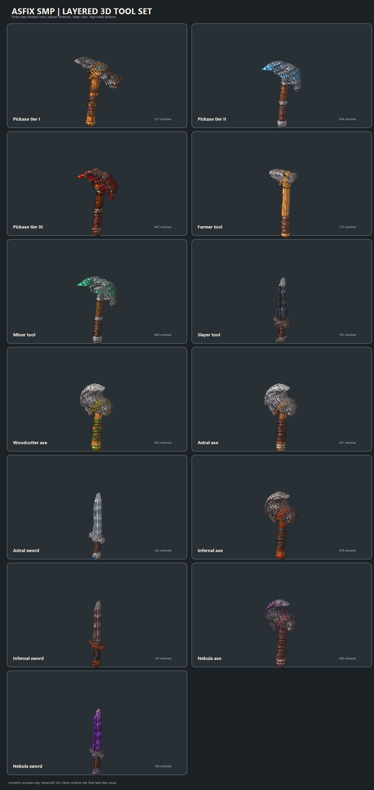

# ASFIX SMP Java Resource Pack — v106.58

[Download for Minecraft Java 26.2](AsfixSMP-Java-ResourcePack-26.2-v106.58-layered-3d-tools.zip)

This release deepens all 13 custom tools with layered, textured cuboid geometry: an outer silhouette shell, a beveled shoulder and a raised core. Each model is built from a 64-slice silhouette, uses separate material textures on the sides, and inherits Minecraft's handheld item pose. Pickaxe and axe heads reach 5.2 model units in depth; sword blades remain slimmer at 3.2 units. The geometry gives the painted metal, wood, leather and gems real volume while retaining Minecraft's voxel language and natural material colors.

The pack also retains the custom natural wood, bronze and jade BetterHud theme, including custom HUD panels, unique icons, hotbar, XP bars and font assets. The HUD layout remains `asfix_hub_hud`.

- Minecraft resource format: `88.0` (26.2)
- Archive entries: `2808`, with no duplicate paths
- Layered volumetric tool models: `13`, with `4836` cuboid elements in total
- New tool face and edge textures: `26`
- BetterHud assets: `647` PNG and `10` JSON files
- Archive size: `26407060` bytes
- SHA-1: `251459C7ACFA2DCD2B5E9F22DF0739E43731E0BE`
- SHA-256: `B8BC68F96CD317ED89F0B1D9DDD01DE1B4212DF25069CC010B60146C1D60B926`

The preview is rendered from the resource-pack model geometry. It is not a live Minecraft screenshot; confirm the final held appearance in a connected 26.2 client.