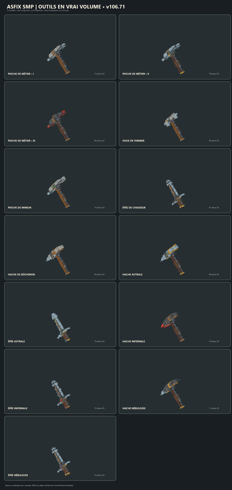

# ASFIX SMP Java Resource Pack — v106.71

[Download the Java 26.2 resource pack](AsfixSMP-Java-ResourcePack-26.2-v106.71-diagonal-volume-tools.zip)

## Handheld tools

This release replaces the previous tool geometry with 13 item models built from 929 individual cuboids. Pickaxes, axes, the farmer's hoe, and swords use a diagonal Minecraft handheld silhouette, visible side thickness, forged metal, natural wood and leather, and restrained ore or gem accents. Each named item has its own geometry cues; the three miner pickaxe tiers are visually distinct.

The models use `minecraft:item/handheld` and apply a 45-degree in-plane rotation to the assembled voxel parts. They are actual cuboid geometry with front and side faces, not a flat sprite with a thin shell. Their dimensions and handed-item transforms remain within Minecraft's 16-unit model space.

The preview is rendered from the JSON geometry and textures. It is useful for checking shape and material assignment, but it is not a screenshot of the Minecraft client. The final held appearance still needs an in-game client check.

## ASFIX HUD

The archive retains the custom BetterHud HUD in the ASFIX natural-material theme: carved dark wood, bronze and steel edging, jade accents, a player head, rank and job details, coordinates, health, armor, hunger, balance, job experience and a framed hotbar. The HUD uses Oxanium and Silkscreen font atlases and includes 655 BetterHud assets.

The HUD source is under `plugins/BetterHud` in the central server folder. BetterHud 2.2.0-SNAPSHOT-449 previously generated the resource-pack assets on an isolated Paper 26.2 smoke server; this release does not claim a fresh in-game HUD screenshot.

## Release validation

- Target: Minecraft Java 26.2, resource-pack format 88.0.
- 13 active 3D tool models, 929 cuboids and 13 dedicated material textures.
- All models inherit `minecraft:item/handheld`; the 13 named item definitions still resolve to those model IDs.
- Every face texture and UV reference resolves; every cuboid has positive volume.
- All rotated model bounds remain inside 0–16 units.
- 2,697 ZIP entries with no duplicate paths; HUD assets are present.
- Archive size: 17,561,932 bytes.
- SHA-1: `0B1378129D0453B77C94D6FB7CA92F499412AFFB`.
- SHA-256: `F87008A573185965B2A8FF3D5A92182679F12D786EAF0B9F7F49AE9F9747625C`.

Full machine-readable release metadata: [`release-v106.71.json`](release-v106.71.json).
