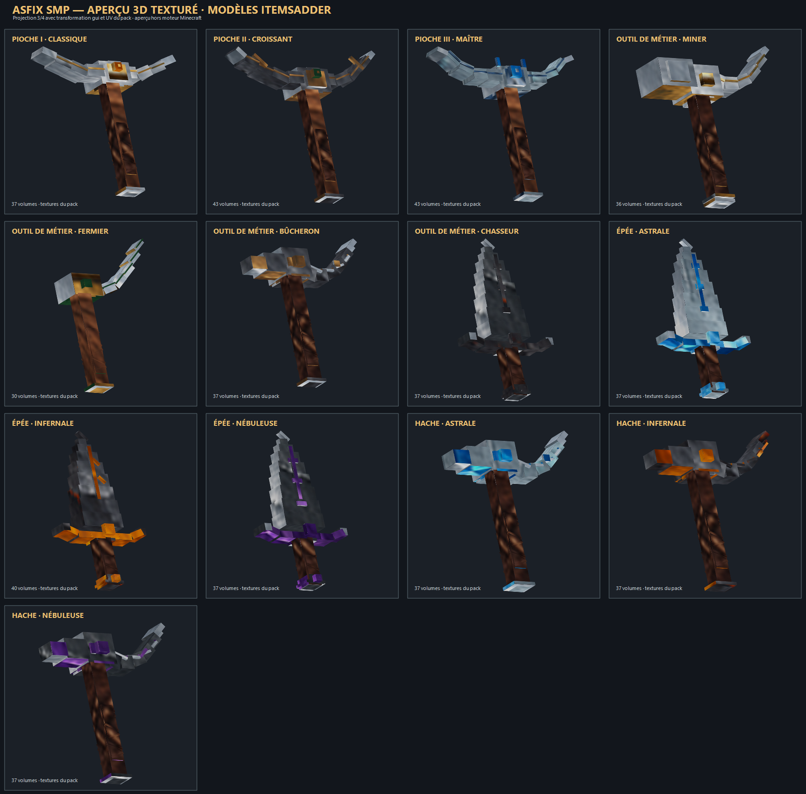
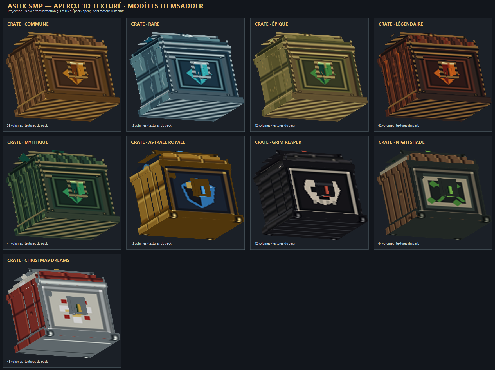

# ASFIX SMP — pack Java 26.2

Pack ItemsAdder et BetterHud pour Minecraft Java 26.2. La direction visuelle ASFIX utilise des matériaux naturels — acier, fer sombre, bois, cuir et bronze — avec des pierres colorées comme accents.

## Publication v106.30

- Pack ItemsAdder avec 13 outils et armes en modèles cuboïdes 3D (3 pioches, 4 outils de métier, 3 épées et 3 haches) et 9 caisses détaillées (5 Cosmic et 4 collections).
- 22 modèles vedettes à géométries distinctes, pour 873 cuboïdes volumétriques; la galerie interactive est disponible dans la documentation centrale.
- Cadres BetterHud raffinés, palette bois sombre / acier / bronze / jade, icônes et police Oxanium.
- Minecraft Java 26.2, format 88.0, overlay BetterHud 26.2.

### Aperçus

Les maquettes et planches sont des projections hors moteur Minecraft. Les objets utilisent une géométrie voxel cuboïde 3D, pas des maillages libres PBR; le rendu final dépend du client, d’ItemsAdder et du pack distribué.

## Archive

- Fichier : `AsfixSMP-Java-ResourcePack-26.2-v106.30.zip`
- Taille : 14 415 645 octets
- SHA-1 : `B5E170AC7457242CD0E64909D4B7933218F04BF3`
- SHA-256 : `49E8085063F2C1364D3AFB6F30F4F331A702FFE5D4CD5A12D2B3BA08A284BE29`
- [Télécharger le pack](AsfixSMP-Java-ResourcePack-26.2-v106.30.zip)
