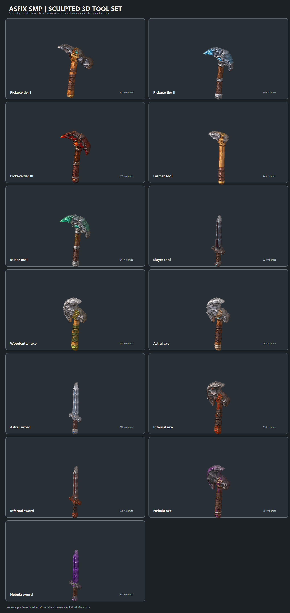

# ASFIX SMP Java Resource Pack — v106.60

[Download the Minecraft Java 26.2 pack](AsfixSMP-Java-ResourcePack-26.2-v106.60-sculpted-voxel-tools.zip)

The gallery shows an offline projection of Minecraft item-model geometry. The HUD image shows its frame art; runtime text and icons are composed from the BetterHud configuration. Neither image is a live Minecraft capture.

## Models and textures

This update refines all 13 custom tools: three miner pickaxes, four job tools, three axes and three swords. Their 8,215 cuboids build seven stepped silhouette and depth bands, including beveled faces, material sides and raised cores. They use Minecraft’s minecraft:item/handheld pose family. Each tool has separate face and edge maps, for 26 unique v106.60 textures. The authored detail is 128×128 and expanded to 512×512 with nearest-neighbour pixels. Natural metal, wood, leather, copper, jade, ember and gem colors remain.

The archive removes 135 superseded tool textures that were no longer referenced. It does not contain duplicate ZIP paths.

## HUD

The combined pack retains the ASFIX BetterHud theme: dark wood, bronze fittings and jade accents, with the custom panel/hotbar frame, player head, role, job, coordinates, health, armor, food, money and job XP. It uses Oxanium SemiBold and Silkscreen. The BetterHud config disables this custom HUD for Bedrock clients.

## Release checks

- Minecraft Java 26.2 resource format: 88.0
- ZIP entries: 2,699, with no duplicate paths
- Volumetric tool models: 13, with 8,215 cuboids total and 967 maximum per model
- Unique tool face and edge textures: 26
- Total archive images/data: 2,262 PNG and 273 JSON files
- Archive size: 16,460,744 bytes
- SHA-1: 9C0F47DB86FDF59B84A65CEE0A72EC5A38C82CE1
- SHA-256: 2B140BBB7087B37B5710104945C9A727382D265B2332ED745E609AD94CE24457

The v106.60 archive passed ZIP integrity, duplicate-path, model-count, parent, texture-reference and format checks. The 2,659 unchanged entries match v106.59 by CRC. In-game held-item poses and the BetterHud overlay still need confirmation in a Minecraft 26.2 client.
