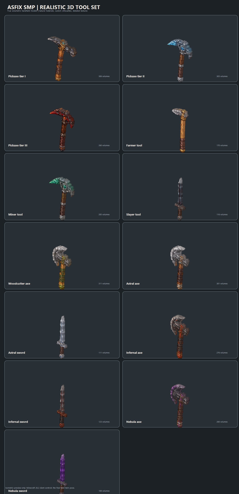

# ASFIX SMP Java Resource Pack — v106.57

[Download for Minecraft Java 26.2](AsfixSMP-Java-ResourcePack-26.2-v106.57-realistic-volumetric-tools.zip)

This release rebuilds all 13 custom pickaxes, profession tools, axes and swords from the high-detail artwork into true volumetric cuboid geometry. Each model uses a 64-slice silhouette, separately textured side faces, a 512-pixel face texture, and the `minecraft:item/handheld` parent so Minecraft keeps the vanilla-style held-tool pose. Pickaxe and axe heads have more depth than their hafts, while sword blades remain slimmer. Materials keep natural steel, wood, leather and gemstone colors.

The archive retains the natural wood, bronze and jade BetterHud theme, including custom HUD panels, unique icons, hotbar, XP bars and font assets. The HUD is configured for Minecraft 26.2 and the `asfix_hub_hud` layout.

- Minecraft resource format: `88.0` (26.2)
- Archive entries: `2782`, with no duplicate paths
- Volumetric tool models: `13`, with `2930` cuboid elements in total
- New 512×512 front textures and material side textures: `26`
- BetterHud assets: `647` PNG and `10` JSON files
- Archive size: `24440135` bytes
- SHA-1: `C4D57DD92330C789045C7D4C066C0A6F463864D8`
- SHA-256: `8864973FDD14156686027C477BD1829E5F9867FC55273680F6D1625ED77DC324`

The preview is rendered from the resource-pack model geometry. It is not a live Minecraft screenshot; final in-hand appearance still needs client-side verification after a client receives this archive.
