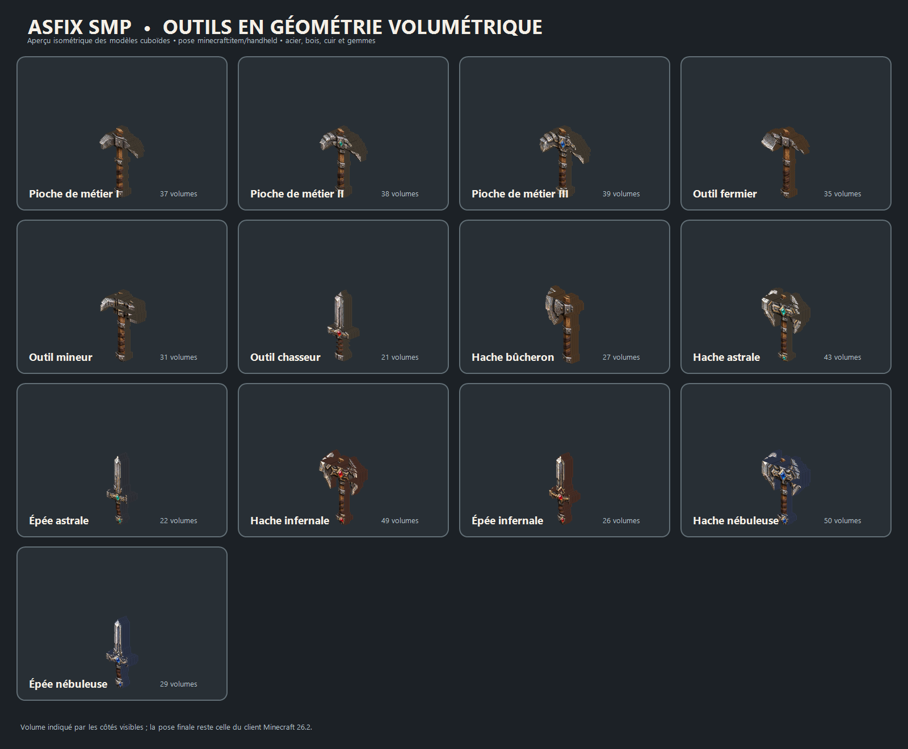

# ASFIX SMP Java Resource Pack — v106.54

[Download for Minecraft Java 26.2](AsfixSMP-Java-ResourcePack-26.2-v106.54-volumetric-tools.zip)

This release upgrades all 13 custom tools and weapons to shaped cuboid geometry while preserving the vanilla `minecraft:item/handheld` grip and pose. The front and back use their detailed 256×256 RGBA art; side faces use item-specific dark forged-metal, wood or blue/red alloy finishes. Each model contains 21–50 cuboid elements, with thickness adjusted between 1.8 and 3.5 model units to fit handles, blades and heads.

The archive also carries the natural wood, bronze and jade BetterHud panels, its seven unique HUD icons, 48 panel tiles, XP bars and compiled font assets. The HUD source is configured for Minecraft 26.2 and the `asfix_hub_hud` layout.

- Minecraft resource format: `88.0` (26.2)
- Archive entries: `2717`, with no duplicate paths
- Volumetric models: `13`
- New material edge textures: `13`
- Compiled BetterHud assets: `657`
- Archive size: `22225197` bytes
- SHA-1: `305E9A0ECC89FC8E96145722BD7B0AD698E871DB`
- SHA-256: `BD8C38400CD35515BE306569D5BE9F88282DE0DF187FB0523F15729E106FEE02`

The preview is rendered from the model JSON geometry for comparison; it is not a screenshot from a live Minecraft client. Final hand pose and pack delivery still require the updated archive to be served and loaded by a Minecraft 26.2 client.
