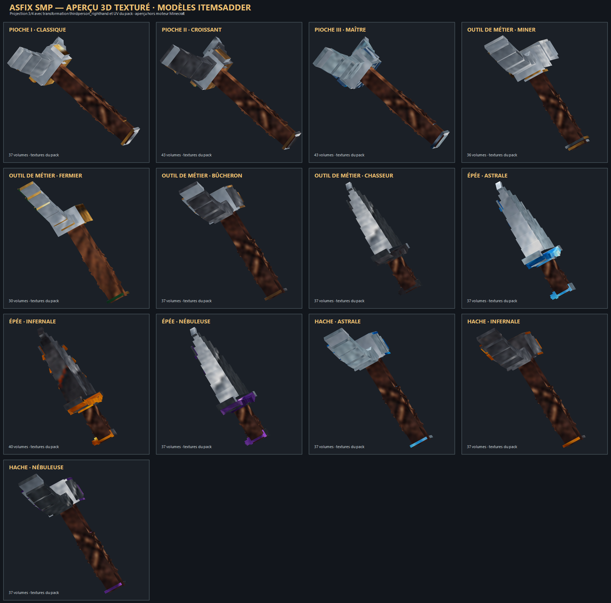

# ASFIX SMP — pack Java

Pack ItemsAdder et BetterHUD pour Minecraft Java 26.2. La direction visuelle ASFIX garde des matériaux naturels — acier, fer sombre, bois, cuir et bronze — avec des gemmes colorées réservées aux accents.

## Publication v106.29

- Reprise de 13 outils et armes en géométrie 3D composée de cuboïdes : trois pioches, quatre outils de métier, trois épées et trois haches.
- Reprise de neuf caisses 3D : cinq niveaux Cosmic et les caisses Astrale Royale, Grim Reaper, Nightshade et Christmas Dreams. Les faces avant, côtés et ferrures ont leurs textures raccordées.
- 22 géométries vedettes distinctes, 873 cuboïdes, 123 modèles et 257 fichiers JSON dans le pack.
- Le HUD ASFIX utilise un cadre bois, bronze et jade, la police Oxanium et ses icônes serveur. En jeu, il affiche notamment le portrait du joueur, le grade, le métier, les coordonnées, les jauges, le solde et la progression XP.
- Minecraft Java 26.2, format 88.0 et overlay BetterHUD 26.2.

### Aperçus

Les planches sont des projections locales des modèles et textures, pas des captures du moteur Minecraft. Le HUD est une maquette de configuration. Les modèles restent des volumes voxel 3D, pas des maillages libres ni des matériaux PBR; l’apparence exacte doit être confirmée avec le client Minecraft, ItemsAdder et le pack chargé.

## Archive

- Fichier : AsfixSMP-Java-ResourcePack-26.2-v106.29.zip
- Taille : 14 792 747 octets
- SHA-1 : EBAA70E6A92C3E2B42190B2BA4C9F48E0078BBE1
- SHA-256 : 0A091FF9933997C3DFF16A5A3521324E6FB883A12A424FCD6C8841E75163D217
- [Télécharger le pack](AsfixSMP-Java-ResourcePack-26.2-v106.29.zip)