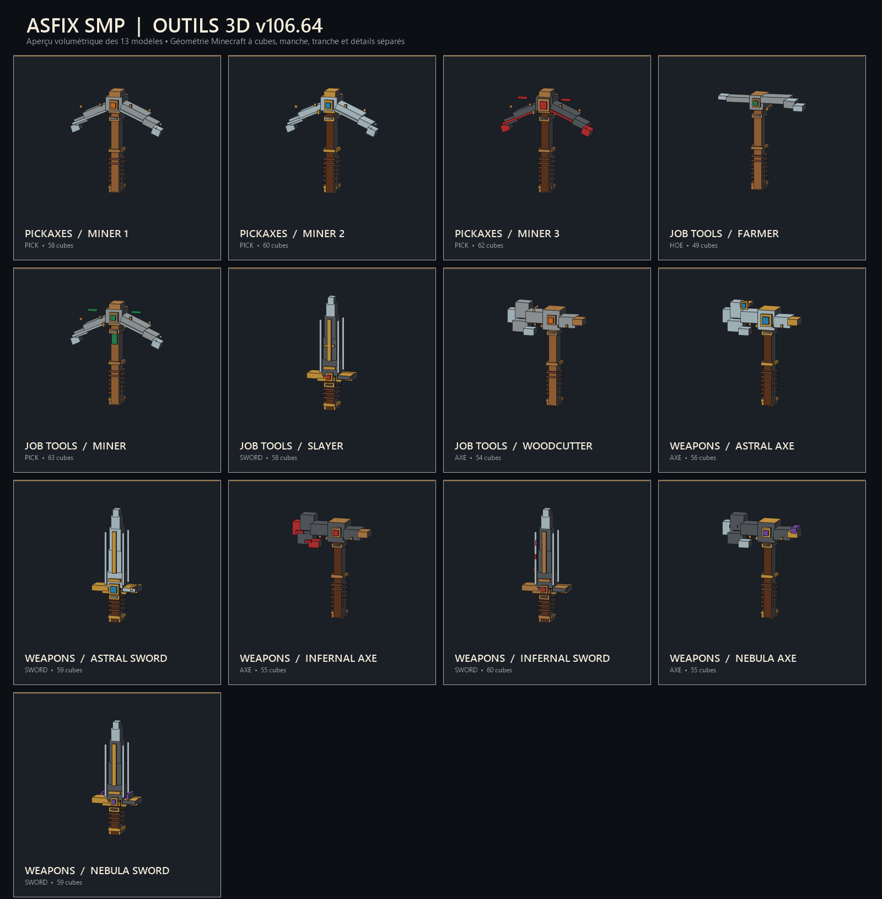
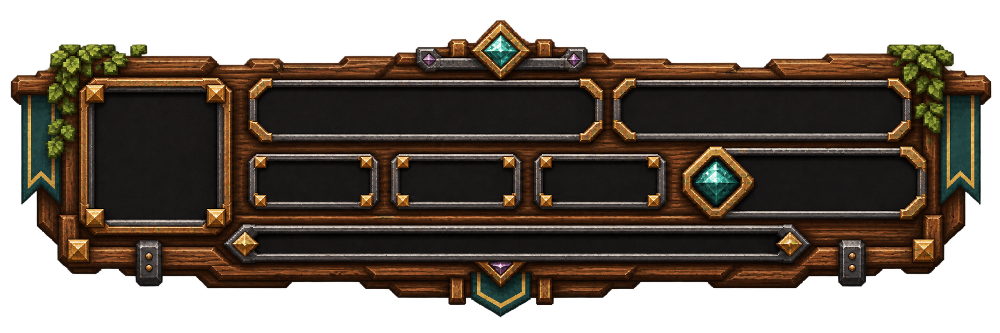

# ASFIX SMP Java Resource Pack — v106.64

[Download the Minecraft Java 26.2 pack](AsfixSMP-Java-ResourcePack-26.2-v106.64-realistic-3d-tools.zip)

The tool gallery is projected from the actual Minecraft model cuboids and their material textures. The geometry uses the native Minecraft handheld item-model format: the tools have depth and separate 3D parts, while retaining the block-built style of vanilla items.

## Tools

The pack contains 13 models: three Miner pickaxes, four job tools, three axes and three swords. The tool models use 748 cuboids total, with 13 different geometry shapes and 13 natural material textures. The pick heads use slimmer forged sockets, tapered wings angled down toward their points, sharpened edge rails and separate rivets. Axes have stepped cutting cheeks and opposing polls; the farmer tool is a hoe; swords have narrow tapered blades, fuller rails and fitted guards. Shafts, grip wraps, collars, guards, blade/head parts and gems are modeled as separate cuboids.

Materials use natural oak and walnut, leather, forged iron, cold steel, dark iron, brass, aged bronze, amber, azurite, emerald, ruby and amethyst. Custom model rotations use Minecraft-supported 22.5 degree steps. No flat sprite is being treated as a 3D tool.

## HUD

The combined pack includes five BetterHud configuration files and the ASFIX theme assets. The theme uses dark wood, bronze fittings and jade accents, with player head, role, job, coordinates, health, armor, food, balance and job XP panels. It includes Oxanium SemiBold and Silkscreen fonts. BetterHud disables the custom HUD for Bedrock clients.

The pack contents and configuration files are present in the release archive. Live BetterHud rendering with the server plugin was not verified in this build.

## Release checks

- Target: Minecraft Java 26.2, resource format 88.0.
- Archive contains 2,712 ZIP entries, with no duplicate paths.
- 13 models and 748 cuboids; 13 distinct shapes.
- 13 natural-material 64×64 textures, all referenced by the models; obsolete v106.61 and v106.63 tool atlases are absent.
- Five BetterHud configuration files are present.
- Archive size: 17,933,605 bytes.
- SHA-1: `A46A1938B2357F7BC04F22E92906F7BCC1C6D205`.
- SHA-256: `FE3CF0A1579B0CC38BFD3299D2775078E2399B1454CF68C08543F8528F957373`.

Automated validation checked each model's geometry bounds, face UVs, texture bindings, custom rotations and rotated bounds. The v106.62 pickaxe was loaded in a local Minecraft 26.2 client and showed visible 3D depth. The updated v106.64 archive passes model, UV, texture, rotation, bounds, duplicate-path and secret-pattern checks. Loading this exact v106.64 archive in Minecraft is still pending.