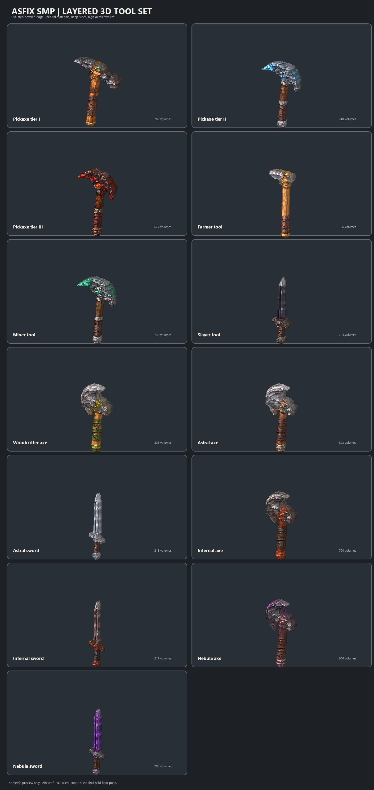

# ASFIX SMP Java Resource Pack — v106.59

[Download for Minecraft Java 26.2](AsfixSMP-Java-ResourcePack-26.2-v106.59-layered-3d-tools.zip)

This release refines the 13 custom tools with five progressive depth bands: the silhouette shell, outer bevel, inner bevel, shoulder and raised core. Their layered cuboid geometry adds a more gradual bevel while keeping a block-built Minecraft shape. Each model uses a 64-slice silhouette, detailed face textures and separate material textures on the edges. Pickaxe and axe heads reach 5.2 model units in depth; sword blades stay slimmer. Materials preserve natural steel, wood, leather and gemstone colors.

The custom BetterHud wood, bronze and jade theme remains included, with its HUD panels, unique icons, hotbar, XP bars and font assets. Its layout is `asfix_hub_hud`.

- Minecraft resource format: `88.0` (26.2)
- Archive entries: `2808`, with no duplicate paths or superseded v106.58 tool textures
- Layered volumetric tool models: `13`, with `7189` cuboid elements in total
- New tool face and edge textures: `26`
- BetterHud assets: `647` PNG and `10` JSON files
- Archive size: `26494794` bytes
- SHA-1: `24AB18448CB26F99565A457AF056CB818F88B0D7`
- SHA-256: `A708AADA012B032295AB52B9C53CB1632ACE6945310D8FCED861E25839AB609C`

The preview is rendered from the resource-pack geometry, not captured from a live Minecraft client. Verify the held-item pose in Minecraft 26.2 after the server sends the pack.