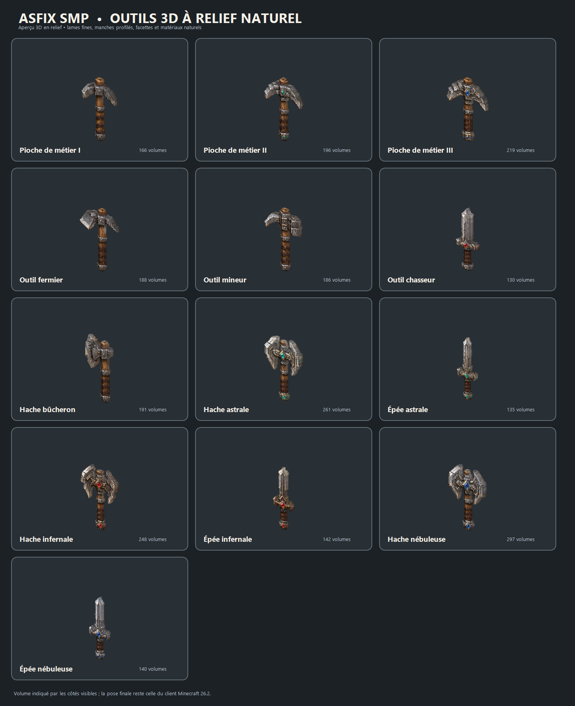

# ASFIX SMP Java Resource Pack — v106.56

[Download for Minecraft Java 26.2](AsfixSMP-Java-ResourcePack-26.2-v106.56-natural-volumetric-tools.zip)

This release rebuilds all 13 custom pickaxes, job tools, axes and swords as detailed volumetric handheld models. They keep Minecraft's `minecraft:item/handheld` grip and pose. Profiled tool heads are deeper than the hafts, sword blades stay slimmer, and each silhouette gets beveled depth from its material shading. Natural steel, wood, leather and gem colors remain visible on the model's sides.

The archive retains the natural wood, bronze and jade BetterHud theme, including the custom HUD panels, icons, hotbar, XP bars and font assets. The HUD is configured for Minecraft 26.2 and the `asfix_hub_hud` layout.

- Minecraft resource format: `88.0` (26.2)
- Archive entries: `2756`, with no duplicate paths
- Volumetric tool models: `13`, with `2499` cuboid elements in total
- New material side textures: `13`
- Compiled BetterHud assets: `658` paths (`647` PNG and `10` JSON assets, plus the directory entry)
- Archive size: `22368212` bytes
- SHA-1: `B7EC8071054B31360B0CAE571C5EAB64F928A183`
- SHA-256: `DAD98CEBE0544EFA3BD03A9D0869B41EB7A6ACAF7D00B39C6D224C0DE65AE258`

The preview is rendered from the resource-pack model geometry. It is not a live Minecraft screenshot; final in-hand appearance still needs client-side verification after the server serves this archive.
