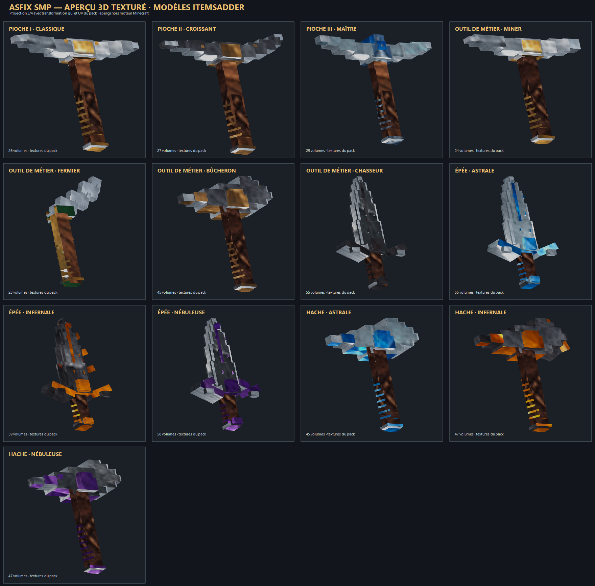
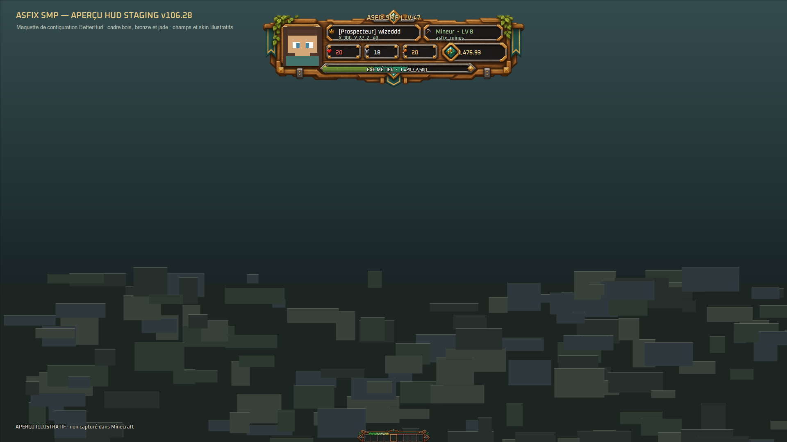

# ASFIX SMP — pack Java

Pack ItemsAdder et BetterHUD pour Minecraft Java 26.2. La direction visuelle ASFIX garde des matériaux naturels — acier, fer sombre, bois, cuir et bronze — avec des gemmes colorées réservées aux accents.

## Publication v106.28

- Reprise de 13 outils et armes en vraie géométrie de cuboïdes 3D : trois pioches, quatre outils de métier, trois épées et trois haches. Chaque modèle a une silhouette en plusieurs volumes, du relief sur le manche et les arêtes, et des textures dédiées.
- Les neuf caisses — cinq Cosmic et quatre caisses associées aux sets Astral Royal, Grim Reaper, Nightshade et Christmas Dreams — restent des modèles 3D distincts.
- 94 fichiers de textures et 22 modèles d’objets sont nouveaux ou actualisés dans la source ItemsAdder v106.28. La galerie interactive locale présente 119 cartes; l’ensemble du pack contient 123 JSON de modèles.
- Le HUD ASFIX reste une interface BetterHUD personnalisée en bois, bronze et jade : tête réelle du joueur en jeu, grade, métier, coordonnées, santé, armure, faim, solde et progression XP. La police Oxanium et les icônes propres au serveur sont conservées.
- Ciblage Minecraft Java 26.2, format 88.0, avec l’overlay BetterHUD 26.2 inclus.

### Aperçus

La galerie interactive de tous les objets se trouve localement dans `docs/apercu-tous-modeles-asfix-v106.28.html`. Les planches sont des projections locales des JSON et textures, pas des captures d’un client Minecraft.

### Limites du rendu

Les armes, outils et caisses utilisent des volumes 3D avec épaisseur sur plusieurs axes. Le format de modèles d’objets vanilla ne fournit pas de maillage libre ni de matériaux PBR; le résultat reste un modèle voxel Minecraft avec des surfaces détaillées, pas un rendu photoréaliste. L’apparence exacte en jeu dépend du client, d’ItemsAdder et du pack chargé.

La maquette HUD reprend une disposition d’aventure avec portrait et barres dédiées, dans le style bois, bronze et jade propre à ASFIX. Elle ne remplace pas une capture client après reconnexion au serveur.

## Archive

- Fichier : `AsfixSMP-Java-ResourcePack-26.2-v106.28.zip`
- Taille : 14 789 004 octets
- SHA-1 : `D0DFCCC3110643C3DE2C80B97DC8B8527D7A20ED`
- SHA-256 : `D7380C00F95941BCCCC7E84B6D80D1E56D12584BC07982E8B8E6618EE1AA1458`
- [Télécharger le pack](AsfixSMP-Java-ResourcePack-26.2-v106.28.zip)
